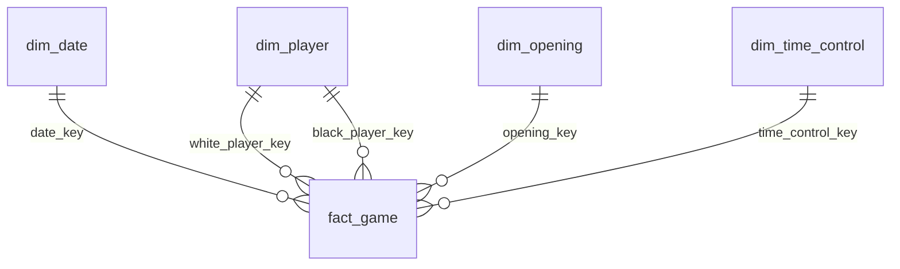

# Docker pipelines and PostgreSQL

## Outline

1. Start Docker and run the tests.
2. Download one archive and execute both engines.
3. Query the PostgreSQL star models.
4. Generate and interpret the comparison.
5. Recover failures and export or stop the database.

## Run from an empty checkout

Install Docker Desktop/Engine with Compose and enable Linux containers. On Windows,
use PowerShell or enable your distribution under Docker Desktop → Settings →
Resources → WSL Integration. No host Python, Java, Spark, or PostgreSQL install is
required. Allow at least 5 GiB of Docker memory and a few GiB of disk space.

From the repository root:

```bash
cp .env.example .env
# Edit .env and choose a local PostgreSQL password.
docker compose build python
docker compose up -d --wait postgres
docker compose run --rm tests
docker compose run --rm fetch
docker compose run --rm python
docker compose run --rm spark
docker compose run --rm compare
```

PowerShell uses `Copy-Item .env.example .env`; the Docker commands are identical.
Reuse an existing `.env` rather than overwriting it. An initialized PostgreSQL
volume retains its original password even if `.env` changes. The local `.env`
created during development is ignored by Git. PostgreSQL is
reachable only on the Compose network: no database port is published to the host.
Container clients get libpq configuration through environment variables. Tests
create and drop a separate disposable database so they cannot replace the real
month's current views or add fixture samples to its benchmark ledger.

All **new runtime, tests, data preparation, loading, and comparison code** executes
inside containers. The previous standalone SQLite/Parquet implementation remains
available as a legacy local example; it is not used for this benchmark.

The archive remains **2013-01 only**. It is SHA-256 verified inside each pipeline;
`fetch` downloads it once into a named volume. Changing `--month` to another month,
a list, or `all` fails the shared safety checks. The all-month flag remains false.

## Architecture and repository structure

```text
Lichess .pgn.zst (shared, verified Docker volume)
    → per-engine stream decompression and bounded JSONL framing
    → Python iterator OR Spark local[2] mapPartitions
    → PGN validation and the same deterministic model transformation
    → PostgreSQL COPY staging in chunks
    → common set-based SQL: deduplicate, build dimensions, load facts
    → constraints and reconciliation
    → atomic publication of <engine>_current views
```

- `framing.py`: stream decompression and JSONL chunks; shared transform adapter.
- `spark_pipeline.py`: typed Spark input/output DataFrames, repartitioning,
  executor parsing, and per-partition bounded PostgreSQL writes.
- `warehouse.py` / `postgres_schema.sql`: staging, bulk COPY, model SQL, constraints,
  retry handling and publication.
- `container_cli.py`: one-month execution, run isolation, timing, metrics and cleanup.
- `comparison.py`: persisted samples, exact model equality and Markdown/JSON reports.
- `docker/`, `compose.yaml`, `scripts/benchmark.sh`: repeatable runtime and benchmark.

Spark really executes parsing/validation on task workers; it does not call the
standalone SQLite pipeline. Both engines use the same Python chess semantics and
PostgreSQL dimensional SQL. This comparison measures serial versus parallel parsing
and staging, including Spark startup, rather than contrasting two different models
or claiming all dimensional transformations happen in Spark SQL. Spark uses local
mode in one container; this is not a multi-node cluster.

Frames contain at most 5,000 games by default. COPY batches also contain at most
5,000 staged records per writer. Spark has two partitions/workers by default; each
worker opens its own PostgreSQL connection. No full-month `collect()` or pandas
conversion occurs. Framing retains one PGN at a time and is specific to the verified
Lichess standard archive (`Event` first); it is not a general PGN import API.

## PostgreSQL data model

Each run owns an isolated schema such as `python_<run suffix>` or `spark_<suffix>`.
`python_current` and `spark_current` are stable schemas containing views of the
last successful run. The six tables have the same field meanings described in
[pipeline.md](pipeline.md), with real PostgreSQL types:

| Table | Grain / primary key | Important PostgreSQL types |
|---|---|---|
| `fact_game` | One valid game / `game_id` | DATE keys/month, INTEGER ratings/counts, DOUBLE PRECISION average, TIMESTAMPTZ ingestion |
| `dim_date` | One observed date / `date_key` | DATE, INTEGER year/month/quarter/weekday |
| `dim_player` | One casefolded username hash / `player_key` | TEXT SHA-256 key, title, DATE latest observation |
| `dim_opening` | One ECO/name combination / `opening_key` | TEXT key, ECO, family, variation |
| `dim_time_control` | One control pair / `time_control_key` | TEXT key, INTEGER seconds/increment, TEXT speed |
| `rejected_game` | One invalid input occurrence / `record_number` | INTEGER key, TEXT reason/stage/ID, TIMESTAMPTZ |

`fact_game` enforces five foreign keys, valid results and non-negative ply counts.



Input record numbers are BIGINT in staging and unique; source data remains in the
bronze archive. All facts/dimensions are created before publication in one database
transaction. Invalid PGN records are retained as rejects; infrastructure errors fail
the run. Duplicate game IDs keep the first valid source occurrence. Titles use the
latest observed date, then last source occurrence and player position as tie-breaks.

`public.pipeline_runs` stores status, schema, timestamps, report JSON and safe error
class names. Staging is unlogged because it is reconstructible; it is dropped after
successful modeling. Model tables are durable, and PostgreSQL's named volume survives
container restarts. Earlier successful run schemas remain for audit/comparison.

Query inside PostgreSQL's container:

```bash
docker compose exec postgres sh -c 'psql -U "$POSTGRES_USER" -d "$POSTGRES_DB" -c "SELECT speed,count(*) FROM python_current.fact_game GROUP BY speed"'
```

[PostgreSQL examples](../sql/postgres_analytics.sql) contain equivalent Spark queries
and the run ledger. All source/game date distinctions and missing-value rules are
shared with the original pipeline.

## Benchmark and comparison

For repeated observations with alternating engine order, use Bash/WSL:

```bash
bash scripts/benchmark.sh 3
```

The script builds once, runs container tests, fetches one archive, executes three
fresh containers per engine sequentially, then compares. Without Bash, repeat the
individual Compose commands and alternate Python/Spark order yourself.

Output files in the host `reports/` directory:

- `comparison.md`: median timing, throughput, CPU, peak memory, and stored model size.
- `comparison.json`: raw eligible samples and table equality checks.
- `<engine>_<run suffix>.json`: individual runtime and phase measurements.

The comparison uses completed runs with the latest common archive/configuration;
fixture runs have another checksum and are excluded from real-month statistics.
It checks all six latest model tables with bidirectional `EXCEPT ALL`, ignoring only
`ingested_at`. A mismatch fails; matching counts alone are insufficient.

Both engine containers use the same image and limits: 2 CPU and 3 GiB memory.
PostgreSQL runs separately with a 1 GiB/2 CPU limit. Measured processing time starts
before archive verification and includes framing, parsing, COPY, dimensional SQL,
validation and Spark startup/shutdown. Image build, HTTP download and comparison
queries are excluded. Per-phase timings identify where time is spent.

CPU is the client-container cgroup usage delta; memory is whole-container cgroup v2
`memory.peak`, including the Spark JVM and Python workers. Missing kernel metrics are
reported as null. PostgreSQL CPU/memory are not attributed to individual pipelines.
Stored bytes include model indexes, excluding staging. A ratio describes these
observations only: one small month cannot establish how Spark scales on large data.

## Failure recovery, persistence and migration

COPY writes to a connection-local temporary batch table, then inserts into staging
with `ON CONFLICT(record_number) DO NOTHING`. A retried Spark task can safely resend
already committed chunks. Session advisory locks prevent two runs of the same engine
from racing publication. Benchmark engines should still run sequentially for useful
timings.

If loading/modeling fails, its private schema is removed and its ledger row marked failed;
current views still reference the previous successful model. If writing a local
report file fails after the database commit, the completed database model and
ledger remain intact; rerun the comparison to regenerate aggregate files.
SIGKILL/database crashes
may leave a running ledger row/private schema. Confirm the process is stopped before
cleaning that specific schema. Avoid broad cleanup of other runs or volumes.

Stop containers while retaining all data:

```bash
docker compose down
```

Do not add `-v` unless deliberately discarding both PostgreSQL and bronze volumes.
To move PostgreSQL data, create a logical dump inside its container:

```bash
docker compose exec -T postgres sh -c 'pg_dump -U "$POSTGRES_USER" -d "$POSTGRES_DB" -Fc' > chess.dump
```

Use Bash/WSL or a binary-safe shell for dump redirection. Restore with `pg_restore`
to a compatible PostgreSQL instance, then validate counts and the five foreign keys.
Keep `.env` private and do not publish dumps containing source/user data.

References: [Docker WSL setup](https://docs.docker.com/desktop/features/wsl/),
[Spark 3.5.7 execution guide](https://spark.apache.org/docs/3.5.7/rdd-programming-guide.html),
[PostgreSQL COPY](https://www.postgresql.org/docs/16/sql-copy.html),
[PostgreSQL constraints](https://www.postgresql.org/docs/16/ddl-constraints.html).

## Tune a matched run

Override the chunk size in both engines, keeping it identical for comparison:

```bash
docker compose run --rm python run --engine python --chunk-size 2000
docker compose run --rm spark run --engine spark --chunk-size 2000 --partitions 2
docker compose run --rm compare
```

The CLI limits chunks to 1–100,000 records and Spark partitions to 1–8. Spark's
local master still runs at most two tasks concurrently. Raising partition count
is not the same as adding CPUs or remote executors. Configuration and source hash
must match between the latest engine samples before the comparison can succeed.
Container memory peaks include charged filesystem cache as well as application
memory; these are not process RSS measurements.

[Executed Docker validation](docker-validation.md) records the observed counts,
three-sample comparison, integration tests, persistence check and image provenance.
