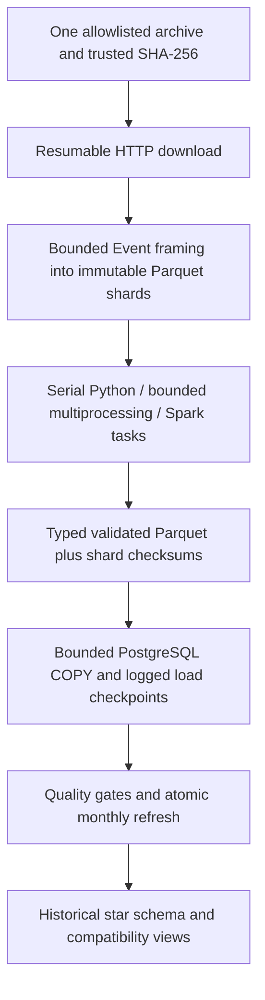

# Optimized historical pipeline

## Outline

1. Input contract and architecture.
2. PostgreSQL data model and publication rules.
3. Independent capacity controls and engine behavior.
4. Recovery, retention, security and backup operations.
5. Benchmark interpretation and capacity limits.

## Input contract and architecture



`optimized/settings.py` validates independent controls. `storage.py` owns framed
Parquet and atomic manifests. `records.py` defines typed observations and shared
PGN parsing; Spark applies native expressions for the derived columns. `engines.py`
implements serial/process/Spark execution. `warehouse.py` loads flat typed records
and publishes historical SQL models. `workflow.py` manages run isolation, explicit
resume, metrics and structured events. `migrate.py` is administrative; it is never
run using the job's loader credentials.

The source contract is a Lichess standard-rated monthly PGN archive with Event as
its first header. File and game byte limits, expected counts, checksums and schema
checks fail closed. This is not a general arbitrary-PGN upload service.

Only `test_month` is allowed by default. Additional archives require explicit
`allowed_months` entries and individual metadata, for example:

```toml
# Example configuration only; not enabled or executed by this repository.
allowed_months = ["2013-01", "YYYY-MM"]
[archives."YYYY-MM"]
sha256 = "<trusted 64-character SHA-256>"
expected_games = 100000000 # Replace with the actual source count.
max_download_bytes = 40000000000
```

Put `allowed_months` at the TOML root, before any table sections. Keep
`all_months_enabled=false`. Byte limits are source-specific; the existing 250 MB
limit deliberately protects the small test archive rather than being a code-level
limit on future catalog entries. An explicit backfill accepts at most six unique,
allowlisted months and processes them sequentially. It never discovers all months.

## Historical PostgreSQL model

| Object | Grain / behavior |
|---|---|
| `fact_game` | One canonical game, monthly DATE source partition, `(source_month,game_id)` primary key; compact dimension keys, titles as played, source record number and run lineage |
| `game_identity` | Global `game_id` registry per engine; enforces unique canonical source ownership across partitions |
| `dim_player` | BIGINT surrogate key, stable 32-byte natural hash, explicit unknown marker; current observed title recomputed for affected players after corrections |
| `dim_opening` | BIGINT surrogate key, stable natural hash, ECO/family/variation |
| `dim_time_control` | BIGINT surrogate key, unique canonical control, seconds/increment/speed |
| `dim_date` | Actual game-start date and calendar attributes; distinct from source month |
| `rejected_game` | One invalid source occurrence per archive month/record number, with reason and run lineage |
| `control.pipeline_runs` | Source, code, image, settings, status, timestamps and per-run report |
| `control.run_shards` | Logged checkpoint per run/shard; data and checkpoint commit together |
| `control.month_publications` | Last committed run and accepted count for each engine/month |

The first successfully published archive owns a game ID. Cross-month repeats count
as duplicates. Refreshing an archive replaces only its partition's facts, rejects,
and identity ownership; other months remain available. If a correction removes an
identity, a subsequent explicit refresh of another archive can claim it. This policy
is deterministic for a fixed backfill order; changing order can change provenance.

Current player titles are not historical attributes. Facts separately retain both
players' titles in that game. Missing titles remain unknown. Unknown player hashes
are pseudonyms; deterministic hashes of public usernames are not anonymization.

Primary keys, seven fact foreign keys (five dimensions, global identity and run
lineage), ratings/results/count constraints, and required types are enforced by SQL.
A candidate month must reconcile its expected input count and satisfy rejection
and unknown-player thresholds before old facts are replaced. New dimensions, facts,
publication metadata and compatibility views commit in the same transaction.

The public compatibility views keep the earlier field names and types, including
hex natural keys and text source months. Query the `warehouse_<engine>` tables for
BIGINT joins and the additional game-time title/provenance fields. Compatibility
integer fields retain the older interface's 32-bit limits; primary tables use wider
keys and record numbers. Shared dimensions retain unused members for stable keys;
active-member comparisons filter them through retained facts.

## Capacity controls

| Setting | Default | Purpose |
|---|---:|---|
| `frame_target_bytes` | 64 MiB | Approximate PGN bytes per framed Parquet shard |
| `max_record_bytes` | 8 MiB | Bound an individual PGN line/game; oversized input fails |
| `parse_batch_rows` | 1,024 | Arrow batches read by Python parsers |
| `copy_batch_rows` | 5,000 | Bounded client rows per COPY operation |
| `python_workers` | 2 | Maximum processes and outstanding parse shards |
| `spark_partitions` | 2 | Spark task parallelism; independent of SQL writers |
| `db_writers` | 2 | Maximum concurrent PostgreSQL connections/loading shards |
| `max_reject_ratio` | 1% | Publication gate for invalid source records |
| `max_unknown_player_ratio` | 1% | Publication gate for otherwise valid games missing an identity |
| `min_free_disk_bytes` | 1 GiB | Minimum working headroom, checked before writes |

These are safe demo defaults, not sizing recommendations for a 30 GB archive.
The disk check detects insufficient headroom; it does not reserve all disk needed
by concurrent processes. Plan for the archive, framed shards, typed outputs, SQL
staging/sorts/WAL, historical indexes and backups. Frame row lists are byte-bounded;
Parquet conversion still temporarily allocates additional buffers.

Spark performs PGN parsing in Python workers and derived columns with native Spark
expressions. It does not collect the full dataset on the driver. Spark writes bounded
batches of shards, and SQL loading has its own connection cap. The default master is
`local[2]`; `SPARK_MASTER` can select a standalone cluster sharing the same `/data`
paths and installed package. The optional Compose profile provides two separate
worker containers on one host. It is not a multi-machine capacity demonstration.

## Recovery and operations

All regular commands execute inside containers:

```bash
docker compose run --rm python status
docker compose run --rm python run --engine python --resume python_<run-id>
docker compose run --rm spark run --engine spark --resume spark_<run-id>
docker compose run --rm python backfill --engine python --months 2013-01
```

Run IDs are printed in structured `run_started`, shard-progress and failure events.
A failed/interrupted run keeps its typed outputs and logged SQL staging. Resume
requires identical source/config/code and verifies committed shard checksums. A
completed run cannot be resumed as a fresh performance sample. Process and database
locks prevent concurrent publication/resume of the same engine/run. After SIGKILL,
status may remain `running`; explicit resume is permitted once both locks are free.

HTTP downloads resume with byte ranges when the server supports them, and safely
restart when it returns a full body. Complete files are trusted only after SHA-256
validation. Wrong cached files fail rather than being silently accepted. Download
partials are retained for retry; bad complete downloads are discarded.

Zstandard framing is sequential. After interruption, preparation may re-decompress
up to the committed record boundary, but does not rewrite verified shards. Parsing
and SQL loading reuse committed work. This is not a claim of random access into a
compressed source file.

A report write failure after SQL commit preserves the completed database model.
Recover the aggregate report by running comparison again. Retention is explicit:

```bash
docker compose run --rm python cleanup --retain-days 7         # dry run
docker compose run --rm python cleanup --retain-days 7 --apply
docker compose run --rm python abandon --resume python_<run-id>
```

Retention protects every current month publication and only removes older completed
run artifacts. It keeps audit metadata and source/frame caches. Abandonment requires
an inactive, unpublished run and makes it non-resumable. No automatic archive cleanup
or all-month streaming is enabled.

## Security and migration

Job containers run as UID 10001. A one-shot root initializer owns only the project
artifact volumes. The administrator applies checksummed migrations and bootstraps
`chess_loader` and `chess_reader`; jobs receive no administrative password. Readers
cannot modify data, and the loader cannot create objects in warehouse schemas.
Narrow security-definer helpers validate identifiers for partition creation,
statistics, staging retirement and compatibility-view publication.

Credentials are local `.env` values and are never committed. The Python base image
and CI checkout action use immutable digests/commits; Python packages are locked.
The PostgreSQL major tag is currently `16`, so record the actual runtime version
when reproducing measurements. Existing baseline schemas are preserved; optimized
schemas and compatibility publication are additive migrations.

## Backup and restore

```bash
docker compose run --rm backup-restore
```

The administrative tools container obtains all three publication locks, exports one
PostgreSQL snapshot, dumps `control`, `staging` and warehouse schemas, and bundles
the pipeline artifact volume. It restores SQL into a disposable database, compares
per-table counts and order-independent row fingerprints, checks constraints and
reader permissions, extracts/verifies the Parquet bundle, and rejects a truncated
dump. SHA-256 files protect the bundle artifacts. No real warehouse is overwritten.

The result is written to `reports/backup-restore.json`; dump/artifact bundles stay
in the `backup-data` volume. Ensure enough space for source artifacts, a backup
copy and temporary extraction. This is a same-instance restore drill, not proof of
off-site disaster recovery or high availability. On a new server bootstrap the
project roles and rerun migrations/grants after restoring; restore artifact paths
under the same `/data` prefix when resuming interrupted work. Stop source preparation
while creating a full artifact bundle; a concurrent file change makes backup fail.

## Benchmark interpretation

`bash scripts/benchmark.sh 3` creates a fresh group, resolves the actual Docker image
ID, prepares the source once, runs fresh serial/process/Spark containers in alternating
order, and validates semantic facts, active dimensions and rejects. Mixed code,
images, source/configuration/resource settings or archive histories fail comparison.
Resumed runs are excluded. Current grouping also records the runtime architecture
and kernel. Source preparation is measured separately from engine timing.

Reports include parse/load/publication phases, real cgroup CPU/memory limits,
client CPU, whole-container peak memory, Parquet size, PostgreSQL size, and measured
SQL execution plans. PostgreSQL CPU/memory are separate from client metrics. On a
remote cluster, driver-container metrics do not include remote worker resources;
the supplied cluster smoke check reports correctness only.

The earlier benchmark included per-engine JSONL preparation and a different missing-
player rejection policy. Do not directly claim a percentage speedup against those
total times. Current comparisons use the same typed input and quality policy.
No 30 GB/month or five-year throughput/SLA claim is supported by the small real month.
